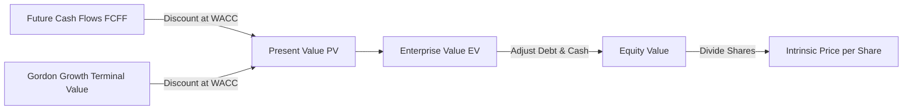
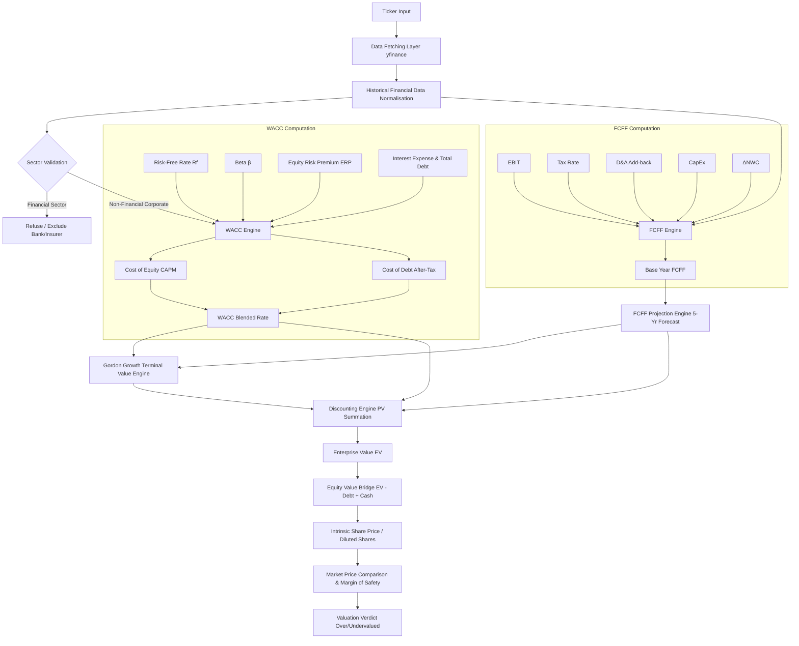
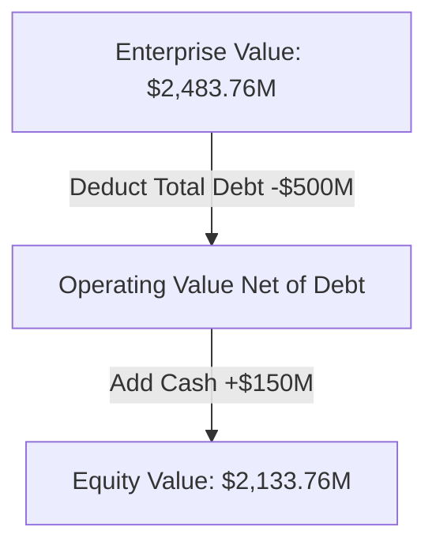
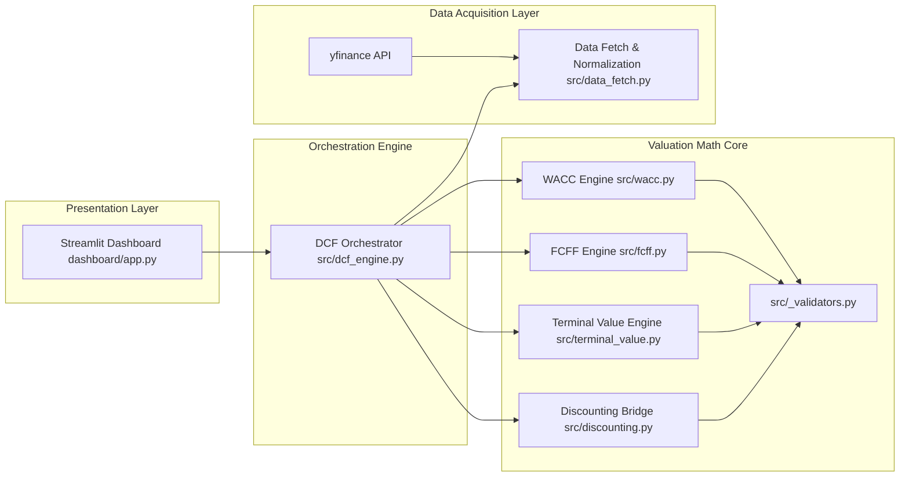
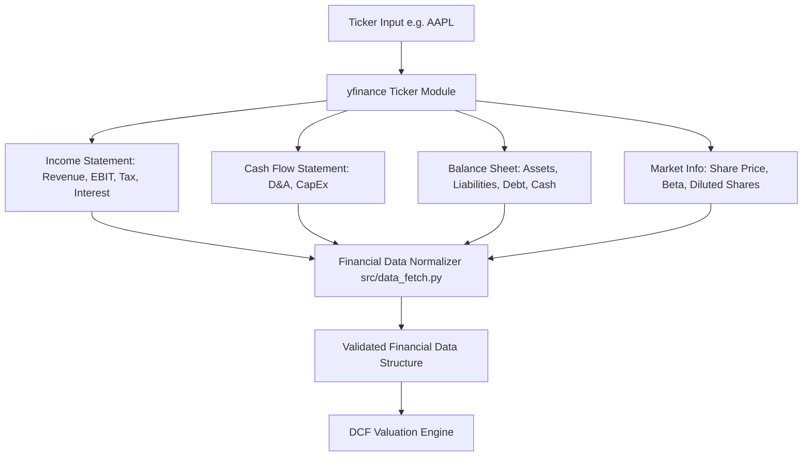
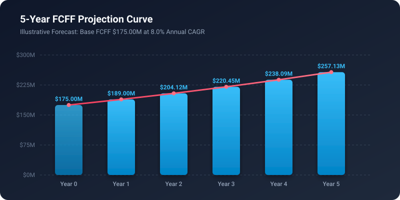
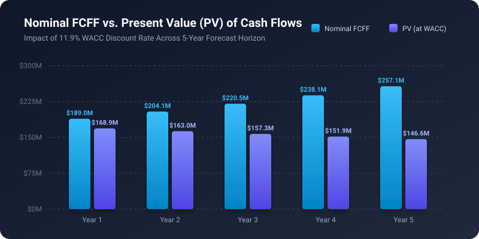
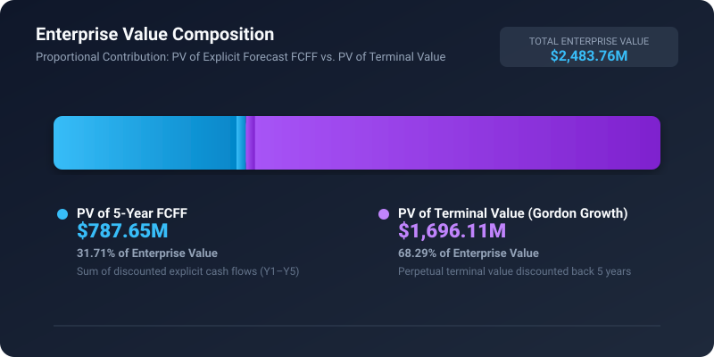
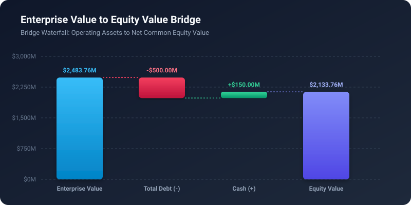
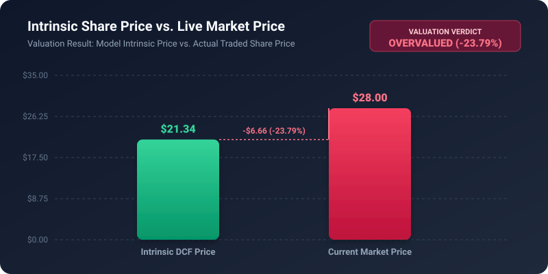

# DCF (Discounted Cash Flow) Valuation Model

> Estimate a company's intrinsic value using a transparent, financially-grounded Discounted Cash Flow engine built in Python.


---

### Project Summary

The **DCF Valuation Model** is a modular, production-ready Python financial engineering toolkit designed to value non-financial corporate issuers. Built with strict separation between financial theory, quantitative calculation engines, data normalization, and presentation UI, this project implements a single-stage Discounted Cash Flow pipeline. It derives Free Cash Flow to Firm (FCFF), calculates the Weighted Average Cost of Capital (WACC) via CAPM and after-tax cost of debt, applies the Gordon Growth Model for Terminal Value, and bridges Enterprise Value to Equity Value to evaluate intrinsic share price against live market prices.

Targeted at equity research analysts, quantitative finance developers, and finance students, this project provides fully explainable, hand-validated financial math without black-box assumptions.

> [!WARNING]
> **EDUCATIONAL FINANCIAL DISCLAIMER**
> This project is an educational financial modeling tool designed to demonstrate corporate valuation methodologies. Its valuation outputs depend heavily on stated assumptions (such as growth rates, equity risk premiums, and discount rates) and should **not** be considered financial, trading, or investment advice.

---

## 2. Project Overview

### What Problem Does This Project Solve?

In public equity markets, market price represents what investors are currently paying for a share of stock based on immediate market sentiment, momentum, and short-term news cycles. However, fundamental investing asks a deeper question: **"What is the business actually worth based on the cash it will generate for capital providers over its lifetime?"**

This project bridges the gap between public market pricing and fundamental intrinsic valuation:

```
┌─────────────────────────────────────────────────────────────────────────────┐
│                             VALUATION PARADIGM                              │
├──────────────────────────────────────┬──────────────────────────────────────┤
│             MARKET PRICE             │           INTRINSIC VALUE            │
│  What investors currently pay for a  │  Estimated value derived strictly    │
│  share based on supply and demand.   │  from expected future cash flows.    │
└──────────────────────────────────────┴──────────────────────────────────────┘
```

By computing intrinsic value through an un-levered cash flow model, the tool provides an objective quantitative benchmark, calculating a **Margin of Safety** to indicate whether a stock is trading at a discount (undervalued) or a premium (overvalued) relative to its fundamental cash-generation potential.

---

## 3. What is DCF?

Discounted Cash Flow (DCF) valuation is built on the foundational financial principle of the **Time Value of Money (TVM)**:

> *A dollar received today is worth more than a dollar received in the future due to its opportunity cost, inflation, and risk.*

### Present Value Formula

To determine the value today of a future cash flow, we apply the discount formula:

$$PV = \frac{FV}{(1 + r)^n}$$

Where:
- $PV$ = Present Value (value today)
- $FV$ = Future Value (nominal cash flow expected in year $n$)
- $r$ = Annual discount rate (representing required risk-adjusted return)
- $n$ = Time horizon in years

### Complete Enterprise DCF Equation

By aggregating discounted projected cash flows over an explicit forecast period and adding the discounted perpetual Terminal Value, we derive total Enterprise Value:

$$\text{Enterprise Value} = \sum_{t=1}^{N} \frac{\text{FCFF}_t}{(1 + \text{WACC})^t} + \frac{\text{Terminal Value}_N}{(1 + \text{WACC})^N}$$



---

## 4. Complete System Flow

The valuation engine executes a sequential 12-stage quantitative pipeline:



---

## 5. Financial Concepts & Definitions

### 5.1 Revenue & Revenue Growth Rate

#### Definition
Revenue (top-line) represents the total gross monetary inflow generated by a business from selling goods or services before deducting any expenses.

#### Formula
$$\text{Revenue Growth Rate} = \frac{\text{Revenue}_t - \text{Revenue}_{t-1}}{\text{Revenue}_{t-1}}$$

#### Variables
- $\text{Revenue}_t$: Gross revenue in current period $t$.
- $\text{Revenue}_{t-1}$: Gross revenue in prior period $t-1$.

#### Why It Matters
Revenue growth is the fundamental top-line expansion driver of future cash generation capacity.

#### Example
If Revenue was \$1,000M in 2024 and \$1,080M in 2025:
$$\text{Growth} = \frac{1080 - 1000}{1000} = 8.0\%$$

#### Role in This Project
Historical revenue growth informs the forward-looking FCFF projection growth rate ($g_{\text{forecast}}$).

---

### 5.2 Compound Annual Growth Rate (CAGR)

#### Definition
CAGR measures the smoothed annualized rate of growth over a multi-year period, eliminating annual volatility.

#### Formula
$$\text{CAGR} = \left( \frac{\text{Ending Value}}{\text{Beginning Value}} \right)^{\frac{1}{n}} - 1$$

#### Variables
- $n$: Number of years between beginning and ending metrics.

#### Why It Matters
CAGR provides a normalized trendline for projecting cash flows over a 5-year explicit horizon.

#### Example
If Revenue grows from \$100M to \$146.93M over 5 years:
$$\text{CAGR} = \left( \frac{146.93}{100} \right)^{\frac{1}{5}} - 1 = (1.4693)^{0.2} - 1 = 8.0\%$$

#### Role in This Project
Used to baseline top-line expansion trends across historical 3–5 year financial statement periods.

---

### 5.3 EBIT (Operating Income)

#### Definition
Earnings Before Interest and Taxes (EBIT) measures the operational profitability of a firm before capital structure (interest) and tax considerations.

#### Why It Matters
FCFF evaluates cash available to **all** capital providers (debt and equity). Therefore, the valuation starting point must be un-levered operating profit (EBIT), excluding financing costs.

#### Role in This Project
Serves as the primary operational input to compute Net Operating Profit After Tax (NOPAT).

---

### 5.4 EBITDA

#### Definition
Earnings Before Interest, Taxes, Depreciation, and Amortization (EBITDA) measures raw operational cash generation before non-cash charges and capital asset consumption.

#### Formula
$$\text{EBITDA} = \text{EBIT} + \text{Depreciation \& Amortization}$$

#### Difference Between EBIT and EBITDA
EBIT includes depreciation expense (accounting for capital asset decay), whereas EBITDA adds back non-cash D&A entirely.

#### Role in This Project
Used for historical financial statement diagnostics and operating margin validation.

---

### 5.5 Tax Rate

#### Definition
The effective corporate tax rate represents the percentage of pre-tax income paid in taxes to regulatory authorities.

#### Formula
$$\text{Effective Tax Rate} = \frac{\text{Income Tax Expense}}{\text{Pretax Pre-Tax Income}}$$

#### Role in This Project
Determines tax deductions on operating earnings and calculates the debt interest tax shield.

---

### 5.6 NOPAT (Net Operating Profit After Tax)

#### Definition
NOPAT represents the total unlevered net profit generated by core business operations assuming the firm has no debt.

#### Formula
$$\text{NOPAT} = \text{EBIT} \times (1 - \text{Tax Rate})$$

#### Numerical Example
For EBIT of \$300M and Tax Rate of 25%:
$$\text{NOPAT} = 300 \times (1 - 0.25) = \$225.00\text{M}$$

#### Role in This Project
First step in deriving Free Cash Flow to Firm (FCFF).

---

### 5.7 Depreciation & Amortization (D&A)

#### Definition
D&A represents non-cash accounting expenses that allocate the historical cost of tangible (depreciation) and intangible (amortization) assets over their useful lives.

#### Why Add Back D&A?
D&A reduces reported net income on the income statement but involves **zero actual cash outflow** during the current period. Therefore, it is added back to NOPAT in cash flow modeling.

#### Role in This Project
Add-back metric in `src/fcff.py:calculate_fcff()`.

---

### 5.8 Capital Expenditure (CapEx)

#### Definition
CapEx represents cash outflows invested in acquiring, upgrading, or maintaining long-term physical assets (property, plant, equipment, technology infrastructure).

#### Why Subtract CapEx?
Unlike D&A, CapEx represents a direct, mandatory cash outflow required to sustain or expand business operations.

#### Role in This Project
Deducted metric in `src/fcff.py:calculate_fcff()`.

---

### 5.9 Net Working Capital (NWC)

#### Definition
Operating Net Working Capital measures operational capital tied up in short-term operating assets and liabilities.

#### Formula
$$\text{NWC} = (\text{Current Operating Assets} - \text{Cash}) - (\text{Current Operating Liabilities} - \text{Short-Term Debt})$$

#### Key Components
- **Accounts Receivable:** Cash owed by customers.
- **Inventory:** Capital tied up in raw materials and unsold goods.
- **Accounts Payable:** Credit extended by suppliers (operating liability).

---

### 5.10 Change in Net Working Capital ($\Delta\text{NWC}$)

#### Formula
$$\Delta\text{NWC} = \text{NWC}_t - \text{NWC}_{t-1}$$

#### Cash Flow Impact
- **Positive $\Delta\text{NWC}$ ($> 0$):** Working capital expanded $\rightarrow$ Cash **outflow** (deducted from FCFF).
- **Negative $\Delta\text{NWC}$ ($< 0$):** Working capital contracted $\rightarrow$ Cash **inflow** (added to FCFF).

---

### 5.11 Free Cash Flow to Firm (FCFF)

#### Definition
FCFF is the total discretionary cash flow generated by core business operations available for distribution to all capital providers (equity holders and debt holders) after paying operating expenses, taxes, CapEx, and working capital investments.

#### Formula
$$\text{FCFF} = \text{EBIT} \times (1 - \text{Tax Rate}) + \text{D\&A} - \text{CapEx} - \Delta\text{NWC}$$

#### Calculation Waterfall

```
    EBIT (Operating Income)
     │
     ├── (-) Corporate Taxes  ─────────────►  NOPAT
     │                                        │
     ├── (+) Depreciation & Amortization ─────┤
     │                                        │
     ├── (-) Capital Expenditures (CapEx) ────┤
     │                                        │
     └── (-) Change in Net Working Capital ───┴──►  FCFF (Unlevered Cash Flow)
```

#### Why FCFF is Discounted at WACC
Because FCFF represents unlevered cash available to both debt and equity providers, it must be discounted using the Weighted Average Cost of Capital (WACC), which reflects the blended required return of all capital sources.

---

## 6. WACC & Cost of Capital

### 6.1 What is Cost of Capital?

To finance operations, companies raise capital from two primary sources: **Equity Investors** and **Debt Providers**. Each capital provider requires a return proportional to the risk they undertake. The company's **Weighted Average Cost of Capital (WACC)** represents its overall blended hurdle rate for discounting cash flows.

---

### 6.2 Cost of Equity (CAPM)

The Capital Asset Pricing Model (CAPM) calculates the required rate of return for equity holders based on systematic market risk:

$$\text{Cost of Equity } (K_e) = R_f + \beta \times \text{ERP}$$

#### Variables
- **$R_f$ (Risk-Free Rate):** Benchmark yield on 10-year government bonds (e.g. 7.0%).
- **$\beta$ (Equity Beta):** Volatility measure of the stock relative to the broad market index.
- **$\text{ERP}$ (Equity Risk Premium):** Expected excess return of equities over risk-free assets (e.g. 5.0%).

#### Numerical Example
$$\text{Cost of Equity} = 0.07 + 1.2 \times 0.05 = 0.13 \quad (13.0\%)$$

---

### 6.3 Beta ($\beta$)

- **$\beta = 1.0$:** Stock moves in exact tandem with the market index.
- **$\beta > 1.0$:** High systemic sensitivity (e.g. Technology, Consumer Discretionary).
- **$\beta < 1.0$:** Low systemic sensitivity (e.g. Utilities, Consumer Staples).

---

### 6.4 Equity Risk Premium (ERP)

$$\text{ERP} = E(R_m) - R_f$$

In this project, ERP is treated as a documented, visible, and overridable user assumption (typically $4.5\% - 6.0\%$).

---

### 6.5 Cost of Debt (After-Tax)

Because corporate interest payments are tax-deductible, debt financing creates an **interest tax shield**. The effective cost of debt is therefore computed after-tax:

$$\text{Pre-Tax Cost of Debt} = \frac{\text{Interest Expense}}{\text{Total Debt}}$$

$$\text{After-Tax Cost of Debt } (K_d) = \left( \frac{\text{Interest Expense}}{\text{Total Debt}} \right) \times (1 - \text{Tax Rate})$$

#### Special Case
If $\text{Total Debt} = 0$, $K_d = 0.0$ to prevent division by zero.

---

### 6.6 Capital Structure Weights

Capital weights are determined by market equity value ($E$) and book total debt ($D$):

$$W_e = \frac{E}{E + D}, \quad W_d = \frac{D}{E + D}$$

Where:
- $E = \text{Current Share Price} \times \text{Diluted Shares Outstanding}$ (Market Capitalization)
- $D = \text{Short-Term Debt} + \text{Long-Term Debt}$

---

### 6.7 Weighted Average Cost of Capital (WACC)

$$\text{WACC} = \left( \frac{E}{E + D} \right) \times K_e + \left( \frac{D}{E + D} \right) \times K_d$$

#### Numerical Worked Example
Given $E = \$2,000\text{M}, D = \$500\text{M}, K_e = 13.0\%, K_d = 7.5\%$:

$$W_e = \frac{2000}{2500} = 0.80 \quad (80\%), \quad W_d = \frac{500}{2500} = 0.20 \quad (20\%)$$

$$\text{WACC} = (0.80 \times 0.13) + (0.20 \times 0.075) = 0.104 + 0.015 = 0.119 \quad (11.9\%)$$

---

## 7. FCFF Forecasting

The model projects FCFF forward over a fixed 5-year explicit forecast horizon using a constant growth rate assumption ($g_{\text{forecast}}$):

$$\text{FCFF}_t = \text{FCFF}_{t-1} \times (1 + g_{\text{forecast}})^t \quad \text{for } t = 1, 2, \dots, 5$$

### Illustrative Forecast Schedule

*Note: The table below represents a hypothetical illustrative example with Base FCFF = \$175.00M, Growth = 8.0%, WACC = 11.9%.*

| Projection Year | Nominal FCFF (\$M) | Growth Rate | Discount Factor $\frac{1}{(1 + \text{WACC})^t}$ | Present Value PV (\$M) |
| :---: | :---: | :---: | :---: | :---: |
| **Year 0 (Base)** | \$175.00M | Base | 1.0000 | \$175.00M |
| **Year 1** | \$189.00M | +8.0% | 0.8937 | \$168.90M |
| **Year 2** | \$204.12M | +8.0% | 0.7986 | \$163.01M |
| **Year 3** | \$220.45M | +8.0% | 0.7137 | \$157.33M |
| **Year 4** | \$238.09M | +8.0% | 0.6378 | \$151.85M |
| **Year 5** | \$257.13M | +8.0% | 0.5700 | \$146.56M |
| **Sum Explicit PV** | — | — | — | **\$787.65M** |

---

## 8. Terminal Value

Since businesses are going concerns that operate indefinitely beyond explicit forecast horizons, we calculate **Terminal Value (TV)** to capture all cash flows in perpetuity starting from Year $N+1$.

### 8.1 Gordon Growth Model

$$\text{Terminal Value}_N = \frac{\text{FCFF}_N \times (1 + g_{\text{terminal}})}{\text{WACC} - g_{\text{terminal}}}$$

Where:
- $\text{FCFF}_N$: Final year projected cash flow (Year 5 FCFF).
- $g_{\text{terminal}}$: Perpetual terminal growth rate (typically capped at long-term GDP growth, $2.0\% - 3.0\%$).

### Critical Mathematical Constraint ($g < \text{WACC}$)

$$\text{Constraint: } g_{\text{terminal}} < \text{WACC}$$

> [!CAUTION]
> **MATHEMATICAL STABILITY CONSTRAINT**
> If $g_{\text{terminal}} \ge \text{WACC}$, the denominator $(\text{WACC} - g)$ evaluates to zero or a negative number, resulting in division by zero or nonsensical negative valuations. Economically, no company can grow faster than its cost of capital in perpetuity. The module `src/terminal_value.py` strictly enforces this check and raises a `ValueError` if violated.

---

## 9. Discounting Future Cash Flows

### Discount Factor Formula

$$\text{Discount Factor}_t = \frac{1}{(1 + \text{WACC})^t}$$

### Present Value of FCFF Series

$$\text{PV}(\text{FCFF}_t) = \text{FCFF}_t \times \text{Discount Factor}_t$$

### Present Value of Terminal Value

$$\text{PV}(\text{Terminal Value}) = \frac{\text{Terminal Value}_N}{(1 + \text{WACC})^N}$$

#### Numerical Example
For Terminal Value \$2,975.80M discounted over 5 years at 11.9% WACC:

$$\text{PV}(\text{TV}) = \frac{2975.802088}{(1.119)^5} = \frac{2975.802088}{1.754486} = \$1,696.11\text{M}$$

---

## 10. Enterprise Value

Enterprise Value (EV) represents the total operating value of the firm available to all providers of capital (both equity and debt).

$$\text{Enterprise Value} = \sum_{t=1}^{N} \text{PV}(\text{FCFF}_t) + \text{PV}(\text{Terminal Value})$$

#### Numerical Worked Example
$$\text{Enterprise Value} = \$787.65\text{M} + \$1,696.11\text{M} = \$2,483.76\text{M}$$

---

## 11. Enterprise Value to Equity Value Bridge

To isolate the value belonging exclusively to common shareholders, we bridge Enterprise Value to Equity Value:

$$\text{Equity Value} = \text{Enterprise Value} - \text{Total Debt} + \text{Cash \& Cash Equivalents}$$



### Why Debt is Subtracted and Cash is Added
- **Subtract Debt:** Debt holders have a senior claim on corporate assets; their debt must be paid off before equity holders receive value.
- **Add Cash:** Non-operating cash and equivalents represent excess non-operating assets available directly to equity owners.

---

## 12. Intrinsic Value Per Share

Dividing Equity Value by the total diluted shares outstanding yields the estimated **Intrinsic Share Price**:

$$\text{Intrinsic Share Price} = \frac{\text{Equity Value}}{\text{Diluted Shares Outstanding}}$$

#### Numerical Worked Example
Given Equity Value = \$2,133.76M and Diluted Shares = 100.0M shares:

$$\text{Intrinsic Share Price} = \frac{2133.762350}{100.0} = \$21.34 \text{ per share}$$

---

## 13. Market Price Comparison

### Margin of Safety

The Margin of Safety quantifies the percentage difference between the calculated Intrinsic Share Price and the live current market price:

$$\text{Margin of Safety (\%)} = \left( \frac{\text{Intrinsic Share Price} - \text{Market Price}}{\text{Market Price}} \right) \times 100$$

```
   Positive Margin of Safety (> 0%)  ──►  Stock is UNDERVALUED (Trading below intrinsic value)
   Negative Margin of Safety (< 0%)  ──►  Stock is OVERVALUED  (Trading above intrinsic value)
```

#### Numerical Worked Example
For Intrinsic Price = \$21.34 and Market Price = \$28.00:

$$\text{Margin of Safety} = \frac{21.3376 - 28.00}{28.00} = -0.2379 \quad (-23.79\% \rightarrow \text{\textbf{OVERVALUED}})$$

---

## 14. Complete DCF Worked Example

Below is a complete, step-by-step worked numerical example linking all 10 test vectors verified by the codebase.

*Label: Hypothetical Illustrative Example*

- **Step 1 — Historical EBIT:** \$300.00M, Effective Tax Rate = 25.0%.
- **Step 2 — NOPAT:** $\$300.00 \times (1 - 0.25) = \$225.00\text{M}$.
- **Step 3 — Add D&A:** $+\$50.00\text{M}$.
- **Step 4 — Subtract CapEx:** $-\$80.00\text{M}$.
- **Step 5 — Subtract $\Delta\text{NWC}$:** $-\$20.00\text{M}$.
- **Step 6 — Calculate Base FCFF:** $\$225.00 + 50 - 80 - 20 = \$175.00\text{M}$.
- **Step 7 — Cost of Equity (CAPM):** $0.07 + 1.2 \times 0.05 = 13.0\%$.
- **Step 8 — Cost of Debt (After-Tax):** $(50 / 500) \times (1 - 0.25) = 7.5\%$.
- **Step 9 — Calculate WACC:** $(2000 / 2500) \times 13.0\% + (500 / 2500) \times 7.5\% = 11.9\%$.
- **Step 10 — 5-Year FCFF Projection (8.0% growth):**
  - Year 1: \$189.00M | PV: \$168.90M
  - Year 2: \$204.12M | PV: \$163.01M
  - Year 3: \$220.45M | PV: \$157.33M
  - Year 4: \$238.09M | PV: \$151.85M
  - Year 5: \$257.13M | PV: \$146.56M
  - **Sum of PV(FCFF):** \$787.65M
- **Step 11 — Terminal Value (3.0% growth):** $[257.1324 \times (1 + 0.03)] / (0.119 - 0.03) = \$2,975.80\text{M}$.
- **Step 12 — PV of Terminal Value:** $\$2975.802088 / (1.119)^5 = \$1,696.11\text{M}$.
- **Step 13 — Enterprise Value:** $\$787.6539 + \$1696.1084 = \$2,483.76\text{M}$.
- **Step 14 — Equity Value:** $\$2483.762350 - \$500.00 (\text{Debt}) + \$150.00 (\text{Cash}) = \$2,133.76\text{M}$.
- **Step 15 — Intrinsic Share Price:** $\$2133.762350 / 100.0 \text{ shares} = \$21.34\text{ per share}$.
- **Step 16 — Market Comparison vs. \$28.00:** Margin of Safety = $-23.79\%$ (**Overvalued**).

---

## 15. Project Architecture

The codebase is organized into decoupled modules following strict single-responsibility principles:

```
dcf-valuation-model/
├── src/
│   ├── __init__.py                 # Package initialization
│   ├── _validators.py              # Internal numeric, type & range validation utilities
│   ├── wacc.py                     # [Implemented - Step 1] CAPM, after-tax Cost of Debt & WACC engine
│   ├── fcff.py                     # [Implemented - Step 1] FCFF historical calculation & forward projection
│   ├── terminal_value.py           # [Implemented - Step 1] Gordon Growth TV & g < WACC constraint guard
│   ├── discounting.py              # [Implemented - Step 1] PV discounting, EV, Equity Value & price bridge
│   ├── data_fetch.py               # [Reserved - Step 2] yfinance statement pulling & normalization
│   └── dcf_engine.py               # [Reserved - Step 3] End-to-end ticker valuation orchestrator
├── dashboard/
│   └── app.py                      # [Reserved - Step 4] Interactive Streamlit dashboard UI
├── tests/
│   ├── test_wacc.py                # Unit tests for WACC engine (TV1, TV2, TV3, TV4, TV10)
│   ├── test_fcff.py                # Unit tests for FCFF calculation & projection (TV5, TV6)
│   ├── test_terminal_value.py      # Unit tests for Gordon Growth TV & constraint enforcement (TV7, TV9)
│   ├── test_discounting.py         # Unit tests for Discounting Bridge & Margin of Safety (TV8)
│   ├── test_integration_step1.py   # Full pipeline composition test chaining TV1->TV8
│   ├── test_data_fetch.py          # Placeholder for Step 2 data layer tests
│   └── test_dcf_engine.py          # Placeholder for Step 3 orchestration tests
├── assets/                         # SVG visual graphics for README documentation
├── notebooks/
│   └── .gitkeep                    # Directory for exploratory research notebooks
├── requirements.txt                # Dependency manifest
├── .gitignore                      # Git exclusion patterns
├── LICENSE                         # MIT License
└── README.md                       # Main project documentation
```

### Module Responsibilities

- [src/wacc.py](file:///Users/TonyStark/Desktop/DCF%20Valuation%20Model/src/wacc.py): Computes CAPM Cost of Equity, after-tax Cost of Debt, and weighted WACC. Rejects negative equity/debt and invalid tax rates.
- [src/fcff.py](file:///Users/TonyStark/Desktop/DCF%20Valuation%20Model/src/fcff.py): Computes base FCFF and projects multi-year FCFF vectors.
- [src/terminal_value.py](file:///Users/TonyStark/Desktop/DCF%20Valuation%20Model/src/terminal_value.py): Computes Gordon Growth Terminal Value. Strictly enforces $g_{\text{terminal}} < \text{WACC}$.
- [src/discounting.py](file:///Users/TonyStark/Desktop/DCF%20Valuation%20Model/src/discounting.py): Performs discounting, sums Enterprise Value, bridges Equity Value, calculates intrinsic share price and margin of safety.

---

## 16. Software Architecture Diagram



---

## 17. Data Pipeline



### Financial Statement Mapping Table

| Data Item | Statement Source | yfinance Attribute | Used For Module |
| :--- | :--- | :--- | :--- |
| **Revenue** | Income Statement | `Ticker.financials` | Growth estimation |
| **EBIT** | Income Statement | `Ticker.financials` | Base FCFF (`src/fcff.py`) |
| **Income Tax Expense** | Income Statement | `Ticker.financials` | Effective Tax Rate |
| **Interest Expense** | Income Statement | `Ticker.financials` | Cost of Debt (`src/wacc.py`) |
| **D&A** | Cash Flow Statement | `Ticker.cashflow` | FCFF Add-back (`src/fcff.py`) |
| **CapEx** | Cash Flow Statement | `Ticker.cashflow` | FCFF Deduction (`src/fcff.py`) |
| **Current Assets & Liabilities** | Balance Sheet | `Ticker.balance_sheet` | $\Delta\text{NWC}$ (`src/fcff.py`) |
| **Total Debt** | Balance Sheet | `Ticker.balance_sheet` | Cost of Debt & Equity Bridge |
| **Cash & Equivalents** | Balance Sheet | `Ticker.balance_sheet` | Equity Value Bridge |
| **Beta ($\beta$)** | Market Metadata | `Ticker.info` | Cost of Equity (`src/wacc.py`) |
| **Diluted Shares** | Market Metadata | `Ticker.info` | Per-Share Price (`src/discounting.py`) |
| **Market Share Price** | Market Metadata | `Ticker.info` | Market Cap & Margin of Safety |

---

## 18. Key Calculation Pipeline

```
STEP 1: Fetch Financials (yfinance API)
        └── Output: Raw financial statements & market metadata

STEP 2: Validate & Normalize Data
        └── Output: Validated metrics (EBIT, Debt, Cash, Shares, Beta)

STEP 3: Calculate WACC
        └── Formula: (E/(E+D))*Ke + (D/(E+D))*Kd
        └── Output: WACC discount rate (e.g. 11.9%)

STEP 4: Calculate Base FCFF
        └── Formula: EBIT*(1-t) + D&A - CapEx - ΔNWC
        └── Output: Year 0 FCFF (e.g. $175.00M)

STEP 5: Project Future FCFF
        └── Formula: Base_FCFF * (1+g)^t for t=1..5
        └── Output: 5-year projected FCFF vector

STEP 6: Calculate Terminal Value
        └── Formula: FCFF_5*(1+g_term) / (WACC - g_term)
        └── Output: Terminal Value as of Year 5 (e.g. $2,975.80M)

STEP 7: Discount Cash Flows
        └── Formula: PV(FCFF_t) and PV(Terminal Value) at WACC
        └── Output: Individual present values

STEP 8: Calculate Enterprise Value
        └── Formula: Sum(PV_FCFF) + PV_TV
        └── Output: Enterprise Value (e.g. $2,483.76M)

STEP 9: Calculate Equity Value
        └── Formula: Enterprise Value - Total Debt + Cash
        └── Output: Implied Equity Value (e.g. $2,133.76M)

STEP 10: Calculate Intrinsic Share Price
        └── Formula: Equity Value / Diluted Shares
        └── Output: Intrinsic Price per Share (e.g. $21.34)

STEP 11: Compare with Market Price
        └── Formula: (Intrinsic Price - Market Price) / Market Price
        └── Output: Margin of Safety (%) & Over/Undervalued Verdict
```

---

## 19. Implemented Features

### Financial Modelling Core
- `[x]` Un-levered Free Cash Flow to Firm (FCFF) calculation.
- `[x]` Capital Asset Pricing Model (CAPM) Cost of Equity.
- `[x]` After-tax Cost of Debt with interest tax shield.
- `[x]` Capital structure weighted WACC.
- `[x]` Multi-year FCFF projection engine.
- `[x]` Gordon Growth Model Terminal Value calculation.
- `[x]` Present Value discounting for cash flow series.
- `[x]` Enterprise Value to Equity Value bridge.
- `[x]` Per-share intrinsic pricing and Margin of Safety verdict.

### Input Validation & Safety
- `[x]` Enforced $g_{\text{terminal}} < \text{WACC}$ guard raising `ValueError`.
- `[x]` Rejection of boolean types passed as numeric arguments across all functions.
- `[x]` Rejection of `NaN`, `Infinity`, negative debt, negative equity, or invalid tax rates ($[0, 1]$).
- `[x]` Zero-debt handling returning $K_d = 0.0$ and WACC $= K_e$.
- `[x]` Undefined capital structure guard ($E=0, D=0$ raising `ValueError`).

---

## 20. Visualisations & Graphs

### Graph 1 — 5-Year FCFF Projection Curve



#### What does this graph show?
The nominal Free Cash Flow to Firm (FCFF) growth curve across the 5-year explicit forecast horizon, starting from a Base FCFF of \$175.00M and compounding at 8.0% annual CAGR to reach \$257.13M in Year 5.

#### Interpretation & Financial Concept
Demonstrates the top-line cash-generation expansion of the business before discounting.

---

### Graph 2 — Nominal FCFF vs. Present Value (PV) of Cash Flows



#### What does this graph show?
Side-by-side comparison of nominal cash flows versus their Present Value (PV) discounted at 11.9% WACC.

#### Interpretation & Financial Concept
Visualizes the **Time Value of Money (TVM)**: although nominal FCFF grows from \$189.00M to \$257.13M, its discounted Present Value decreases from \$168.90M to \$146.56M due to the compounding effect of the 11.9% discount rate over time.

---

### Graph 3 — Enterprise Value Composition



#### What does this graph show?
The proportional breakdown of Enterprise Value (\$2,483.76M) between explicit 5-year FCFF (\$787.65M / 31.71%) and perpetual Terminal Value (\$1,696.11M / 68.29%).

#### Interpretation & Financial Concept
Illustrates that in single-stage DCF models, Terminal Value typically accounts for 60%–80% of total Enterprise Value, highlighting the model's sensitivity to perpetual growth rate ($g_{\text{terminal}}$) assumptions.

---

### Graph 4 — Enterprise Value to Equity Value Bridge



#### What does this graph show?
Waterfall bridge displaying the transition from Enterprise Value (\$2,483.76M) to Equity Value (\$2,133.76M) by subtracting Total Debt (-\$500.00M) and adding Cash (+\$150.00M).

#### Interpretation & Financial Concept
Shows how non-operating capital structure adjustments isolate the net value attributable to common equity shareholders.

---

### Graph 5 — Intrinsic Value vs. Live Market Price



#### What does this graph show?
Direct comparison between calculated Intrinsic Share Price (\$21.34) and current Market Share Price (\$28.00).

#### Interpretation & Financial Concept
Displays the final valuation output and Margin of Safety (-23.79%), indicating that the stock is currently **Overvalued** relative to its intrinsic valuation model.

---

## 21. Dashboard Section

*(Planned Streamlit Architecture for Step 4)*

```
┌─────────────────────────────────────────────────────────────────────────────┐
│                       DCF VALUATION MODEL DASHBOARD                         │
├─────────────────────────────────────────────────────────────────────────────┤
│ TICKER INPUT: [ AAPL ]                                                      │
├──────────────────────────────────────┬──────────────────────────────────────┤
│ ASSUMPTION CONTROLS                  │ VALUATION OUTPUT SUMMARY             │
│ • Revenue Growth Rate: 8.0%          │ • WACC: 11.90%                       │
│ • Terminal Growth Rate: 3.0%         │ • Enterprise Value: $2,483.76M       │
│ • Equity Risk Premium: 5.0%          │ • Equity Value: $2,133.76M           │
│ • Risk-Free Rate: 7.0%               │ • Intrinsic Share Price: $21.34      │
│ • Forecast Horizon: 5 Years          │ • Current Market Price: $28.00       │
│                                      │ • Margin of Safety: -23.79% (OVER)   │
└──────────────────────────────────────┴──────────────────────────────────────┘
```

---

## 22. Installation

### 1. Clone the Repository
```bash
git clone https://github.com/amateurcoder015/DCF-Valuation-Model.git
cd DCF-Valuation-Model
```

### 2. Set Up Virtual Environment
```bash
python3 -m venv .venv
source .venv/bin/activate
```

### 3. Install Dependencies
```bash
pip install -r requirements.txt
```

---

## 23. Usage

### Programmatic Usage (Python API)

```python
from src.wacc import cost_of_equity, cost_of_debt_after_tax, wacc
from src.fcff import calculate_fcff, project_fcff
from src.terminal_value import gordon_growth_terminal_value
from src.discounting import enterprise_value, equity_value, intrinsic_share_price, margin_of_safety

# 1. Compute Cost of Capital (WACC)
ke = cost_of_equity(risk_free_rate=0.07, beta=1.2, equity_risk_premium=0.05)
kd = cost_of_debt_after_tax(interest_expense=50.0, total_debt=500.0, tax_rate=0.25)
wacc_val = wacc(market_value_equity=2000.0, total_debt=500.0, cost_of_equity=ke, cost_of_debt_after_tax=kd)

# 2. Compute Base FCFF & Forecast
base_fcff = calculate_fcff(ebit=300.0, tax_rate=0.25, depreciation_amortization=50.0, capex=80.0, change_in_nwc=20.0)
fcff_proj = project_fcff(base_fcff=base_fcff, growth_rate=0.08, years=5)

# 3. Compute Terminal Value & Enterprise Value
tv = gordon_growth_terminal_value(final_year_fcff=fcff_proj[-1], terminal_growth_rate=0.03, wacc=wacc_val)
ev = enterprise_value(fcff_projection=fcff_proj, terminal_value=tv, wacc=wacc_val)

# 4. Bridge Equity Value & Calculate Share Price
eq_val = equity_value(enterprise_value=ev, total_debt=500.0, cash_and_equivalents=150.0)
price = intrinsic_share_price(equity_value=eq_val, diluted_shares_outstanding=100.0)
mos = margin_of_safety(intrinsic_price=price, market_price=28.0)

print(f"Intrinsic Share Price: ${price:.2f}")
print(f"Margin of Safety: {mos * 100:.2f}%")
```

### Running Test Suite
```bash
python3 -m pytest -v
```

---

## 24. Example Output

*Label: Hypothetical Illustrative Example*

| Metric | Output Value | Unit / Format |
| :--- | :---: | :---: |
| **Risk-Free Rate ($R_f$)** | `7.00%` | Decimal (0.07) |
| **Equity Beta ($\beta$)** | `1.20` | Volatility index |
| **Cost of Equity ($K_e$)** | `13.00%` | CAPM rate |
| **After-Tax Cost of Debt ($K_d$)** | `7.50%` | Tax-adjusted rate |
| **WACC** | `11.90%` | Blended hurdle rate |
| **Base Year FCFF** | `$175.00M` | Cash flow |
| **5-Year Projected FCFF Sum (PV)** | `$787.65M` | Discounted cash flow |
| **Terminal Value ($TV_5$)** | `$2,975.80M` | Nominal TV |
| **PV of Terminal Value** | `$1,696.11M` | Discounted TV |
| **Enterprise Value (EV)** | `$2,483.76M` | Total firm value |
| **Total Debt** | `$500.00M` | Balance sheet liability |
| **Cash & Cash Equivalents** | `$150.00M` | Balance sheet asset |
| **Equity Value** | `$2,133.76M` | Net common equity |
| **Diluted Shares Outstanding** | `100.00M` | Share count |
| **Intrinsic Share Price** | **`$21.34`** | Model value per share |
| **Current Market Price** | **`$28.00`** | Traded share price |
| **Margin of Safety (%)** | **`-23.79%`** | Discrepancy % |
| **Valuation Verdict** | **OVERVALUED** | Model verdict |

---

## 25. Validation & Testing

The project maintains 100% test coverage across all financial functions using `pytest`:

```
tests/test_wacc.py ........                                              [ 33%]
tests/test_fcff.py ......                                                [ 58%]
tests/test_terminal_value.py .....                                       [ 79%]
tests/test_discounting.py ....                                           [ 95%]
tests/test_integration_step1.py .                                        [100%]

============================== 24 passed in 0.06s ==============================
```

### Key Hand-Validated Test Vectors
- **Test Vector 1:** CAPM Cost of Equity ($0.07 + 1.2 \times 0.05 = 0.13$).
- **Test Vector 2:** After-tax Cost of Debt ($(50/500) \times (1 - 0.25) = 0.075$).
- **Test Vector 3:** Weighted WACC ($0.80 \times 0.13 + 0.20 \times 0.075 = 0.119$).
- **Test Vector 4:** Zero-debt WACC validation ($D=0 \rightarrow \text{WACC} = K_e = 0.13$).
- **Test Vector 5:** Base FCFF ($300 \times 0.75 + 50 - 80 - 20 = 175.0$).
- **Test Vector 6:** 5-year FCFF projection vector ($189.00, 204.12, 220.45, 238.09, 257.13$).
- **Test Vector 7:** Gordon Growth Terminal Value ($257.1324 \times 1.03 / (0.119 - 0.03) = 2975.80$).
- **Test Vector 8:** Full discounting bridge ($\text{EV} = 2483.76, \text{Equity} = 2133.76, \text{Price} = \$21.34$).
- **Test Vector 9:** Exception test verifying $g \ge \text{WACC}$ raises `ValueError`.
- **Test Vector 10:** Exception test verifying $E=0, D=0$ raises `ValueError`.

---

## 26. Financial Model Validation

To verify mathematical accuracy, developers and analysts can hand-validate code outputs against textbook financial formulas:

1. **WACC Validation:** Verify $W_e \times K_e + W_d \times K_d$ using financial calculator.
2. **FCFF Validation:** Confirm NOPAT $+ \text{D\&A} - \text{CapEx} - \Delta\text{NWC}$ matches income statement adjustments.
3. **Terminal Value Validation:** Verify Gordon Growth formula $FCFF_N \times (1+g) / (WACC - g)$.
4. **Bridge Validation:** Confirm $\text{EV} - \text{Debt} + \text{Cash} = \text{Equity Value}$ and $\text{Equity Value} / \text{Shares} = \text{Price}$.

---

## 27. Assumptions Reference Table

| Assumption Input | Financial Meaning | Valuation Impact |
| :--- | :--- | :--- |
| **Revenue Growth Rate ($g_{\text{forecast}}$)** | Projected top-line annual compounding rate | Higher growth increases FCFF projections and Enterprise Value. |
| **Terminal Growth Rate ($g_{\text{terminal}}$)** | Perpetual perpetual growth rate beyond Year 5 | Higher terminal growth significantly increases Terminal Value. |
| **Risk-Free Rate ($R_f$)** | Benchmark 10-year government bond yield | Higher risk-free rate increases WACC, lowering present value. |
| **Equity Risk Premium (ERP)** | Required excess equity market return | Higher ERP increases Cost of Equity and WACC. |
| **Beta ($\beta$)** | Volatility of stock relative to market index | Higher Beta increases Cost of Equity and WACC. |
| **Tax Rate ($t$)** | Corporate effective income tax rate | Reduces NOPAT but increases interest debt tax shield. |
| **Forecast Horizon ($N$)** | Years of explicit cash flow projection | Longer forecast horizons shift weight from Terminal Value to FCFF. |

---

## 28. Limitations

1. **Single-Stage Model:** Assumes constant growth during forecast horizon and constant perpetual growth thereafter; does not model complex high-growth fade phases.
2. **High Sensitivity:** Small 50 bps shifts in WACC or terminal growth can cause significant changes in intrinsic share price.
3. **Terminal Value Weight:** Terminal Value often accounts for 60%–80% of Enterprise Value.
4. **Data Provider Variability:** Historical financial data retrieved via `yfinance` may contain reporting format variations or restatements.
5. **Simplified Cost of Debt:** Uses interest expense over total debt rather than yield-to-maturity on individual corporate bonds.
6. **Financial Sector Exclusion:** Does not support banking or insurance tickers.

---

## 29. Why Financial Companies Are Excluded

Financial institutions (banks, investment firms, insurance companies) are deliberately excluded from standard FCFF DCF valuation for fundamental accounting reasons:

1. **Debt as Operating Inventory:** For banks, interest-bearing debt and deposits are not capital structure choices—they are primary operating line items (raw inventory used to generate interest income).
2. **Working Capital Ambiguity:** Concepts like Current Assets and Net Working Capital do not apply to bank balance sheets.
3. **Regulatory Capital Requirements:** Bank cash flows are dictated by regulatory capital ratios (Tier 1 Equity) rather than CapEx investments.

*Note: Financial sector issuers require specialized valuation models such as the Dividend Discount Model (DDM) or Residual Income Model.*

---

## 30. Formula Reference Table

| Concept | Mathematical Formula |
| :--- | :--- |
| **Revenue Growth** | $(\text{Revenue}_t - \text{Revenue}_{t-1}) / \text{Revenue}_{t-1}$ |
| **CAGR** | $(\text{End} / \text{Begin})^{(1/n)} - 1$ |
| **NOPAT** | $\text{EBIT} \times (1 - \text{Tax Rate})$ |
| **FCFF** | $\text{EBIT} \times (1 - \text{Tax Rate}) + \text{D\&A} - \text{CapEx} - \Delta\text{NWC}$ |
| **Cost of Equity (CAPM)** | $R_f + \beta \times \text{ERP}$ |
| **After-Tax Cost of Debt** | $(\text{Interest Expense} / \text{Total Debt}) \times (1 - \text{Tax Rate})$ |
| **WACC** | $(E / (E + D)) \times K_e + (D / (E + D)) \times K_d$ |
| **FCFF Projection** | $\text{FCFF}_t = \text{FCFF}_{t-1} \times (1 + g)^t$ |
| **Discount Factor** | $1 / (1 + \text{WACC})^t$ |
| **Terminal Value (Gordon Growth)** | $[\text{FCFF}_N \times (1 + g_{\text{terminal}})] / (\text{WACC} - g_{\text{terminal}})$ |
| **Enterprise Value (EV)** | $\sum [\text{FCFF}_t / (1 + \text{WACC})^t] + [\text{TV}_N / (1 + \text{WACC})^N]$ |
| **Equity Value** | $\text{Enterprise Value} - \text{Total Debt} + \text{Cash \& Cash Equivalents}$ |
| **Intrinsic Share Price** | $\text{Equity Value} / \text{Diluted Shares Outstanding}$ |
| **Margin of Safety** | $[(\text{Intrinsic Price} - \text{Market Price}) / \text{Market Price}] \times 100$ |

---

## 31. Project Roadmap

### Current Implemented Scope (v1)
- `[x]` Step 1: Core Financial Math Engine (`src/wacc.py`, `src/fcff.py`, `src/terminal_value.py`, `src/discounting.py`).
- `[x]` 100% test coverage across 24 unit and integration test vectors (`tests/`).
- `[x]` Defensive validation layer (`src/_validators.py`).

### Planned Future Extensions
- `[ ]` Step 2: Data Acquisition & Normalization Layer (`src/data_fetch.py` via `yfinance`).
- `[ ]` Step 3: End-to-End DCF Orchestration Engine (`src/dcf_engine.py`).
- `[ ]` Step 4: Single-Page Interactive Streamlit Dashboard (`dashboard/app.py`).
- `[ ]` Multi-Stage Growth (2-Stage / 3-Stage Fade Models).
- `[ ]` Sensitivity Analysis Grid (WACC $\times$ Terminal Growth matrix).

---

## 32. Learning Outcomes

### Financial Engineering
- Applied corporate valuation theory and un-levered cash flow mechanics.
- CAPM risk-adjusted hurdle rate estimation and WACC blending.
- Perpetual terminal value modeling under economic growth constraints ($g < \text{WACC}$).
- Enterprise Value to Equity Value capital structure bridging.

### Software Architecture
- Clean modular design with strict separation of financial math, data fetching, and UI layers.
- Test-Driven Development (TDD) using `pytest` and pre-computed test vectors.
- Robust defensive validation against invalid numerical inputs, type mismatches, and boundary conditions.

---

## 33. Tech Stack

| Technology | Purpose |
| :--- | :--- |
| **Python 3.10+** | Primary programming language |
| **NumPy** | High-performance numerical computations |
| **Pandas** | Financial statement parsing & matrix operations |
| **yfinance** | Automated financial data acquisition API |
| **Streamlit** | Interactive web application framework (Step 4) |
| **pytest** | Automated test suite and vector validation |
| **Git / GitHub** | Version control & open-source repository hosting |

---

## 34. Repository Structure

```
DCF Valuation Model/
├── assets/
│   ├── ev_composition.svg
│   ├── ev_to_equity_bridge.svg
│   ├── fcff_projection.svg
│   ├── intrinsic_vs_market.svg
│   └── pv_cash_flows.svg
├── dashboard/
│   └── app.py
├── notebooks/
│   └── .gitkeep
├── src/
│   ├── __init__.py
│   ├── _validators.py
│   ├── data_fetch.py
│   ├── dcf_engine.py
│   ├── discounting.py
│   ├── fcff.py
│   ├── terminal_value.py
│   └── wacc.py
├── tests/
│   ├── test_data_fetch.py
│   ├── test_dcf_engine.py
│   ├── test_discounting.py
│   ├── test_fcff.py
│   ├── test_integration_step1.py
│   ├── test_terminal_value.py
│   └── test_wacc.py
├── .gitignore
├── LICENSE
├── README.md
└── requirements.txt
```

---

## 35. Financial Disclaimer

This repository is created for educational and quantitative financial engineering research purposes. Valuation calculations generated by this model rely on user-selected growth rates, discount rates, and perpetual assumptions. The computed intrinsic share price is a mathematical model result and does not constitute financial, investment, or trading advice.

---

## 36. Contributing

Contributions, bug reports, and feature requests are welcome!

1. Fork the Repository.
2. Create a Feature Branch (`git checkout -b feature/FinancialExtension`).
3. Commit Changes (`git commit -m 'Add 2-stage growth model'`).
4. Push to Branch (`git push origin feature/FinancialExtension`).
5. Open a Pull Request.

---

## 37. License

Distributed under the MIT License. See [LICENSE](LICENSE) for details.
